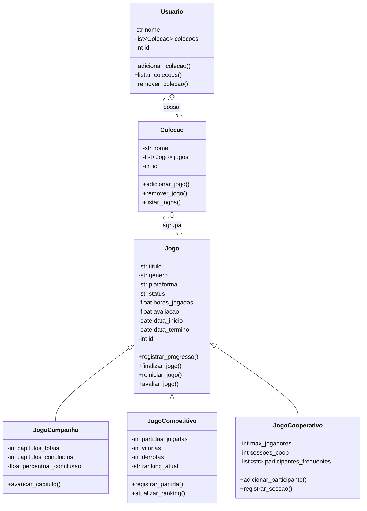

## 🏗️ Estrutura de Classes (Diagrama UML)

Com o intuito de não poluir a representação visual, decidi omitir os **métodos especiais** e os **atributos derivados** (obtidos via *getters*). Também optei por não representar as duas classes de repositório (CatalogoJSON e ConfiguracaoJSON), uma vez que elas têm estruturas simples e não estão relacionadas ao problema

